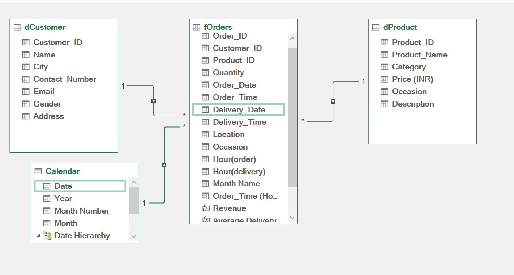

# 📈 Commercial Revenue & Sales Performance Intelligence

---

## Project Overview
An end-to-end commercial revenue analytics solution built in Microsoft Excel using Power Query, Power Pivot (Star Schema), and advanced DAX to evaluate sales velocity, order fulfillment lead times, and customer spending behavior across products, cities, and seasonal occasions.

---

## Business Problem
Commercial leadership and sales directors lacked consolidated visibility into revenue performance, order volume dynamics, and logistics delivery lead times across disparate product categories and regional cities. Unmonitored discounting eroded product margins, while logistical fulfillment delays damaged customer satisfaction across key regional markets. This created an urgent need for an interactive diagnostic dashboard to optimize commercial operations.

---

## Solution
Automated multi-table transactional data ingestion (`customers`, `orders`, `products`) via **Power Query**, cleansing data types and extracting temporal dimensions. Architected an enterprise **Star Schema** in **Power Pivot** linking dimension tables (`dCustomer`, `dProduct`, `Calendar`) to the central fact table (`fOrders`), and authored calculated **DAX** measures to build an interactive executive dashboard with multi-dimensional slicers.

---

## Dashboard Preview

### 1. Executive Revenue & Operations Dashboard

* **What it shows:** Executive KPIs, monthly revenue trajectories, category revenue breakdowns, top purchasing cities, peak ordering hours, and occasion-based sales performance.
* **Business Value:** Delivers a single source of truth for commercial directors to track revenue velocity, spot seasonal demand shifts, and audit fulfillment lead times across regional markets.

---

### 2. Star Schema Data Architecture

* **What it shows:** A normalized relational data model in Power Pivot with 1-to-many single-direction relationships connecting customer, product, and calendar dimensions to order transactions.
* **Business Value:** Eliminates data redundancy, enables scalable multi-dimensional cross-filtering, and ensures consistent DAX metric calculation without performance lag.

---

## Key Insights

* **Top-Line Revenue Concentration in Core Categories:**
  * **Finding:** Three product categories generate the vast majority of gross revenue, while others lag behind.
  * **Evidence:** Total revenue reached **\$3,520,984** across 1,000 orders (**\$3,521 AOV**), with **"Colors" (\$1.02M)**, **Soft Toys (\$740K)**, and **Sweets (\$730K)** driving ~71% of revenue.
  * **Business Meaning:** Commercial margins depend heavily on three core lines; underperforming categories like Plants (\$210K) need strategic cross-selling.

* **Severe Demand Seasonality & Occasion Spikes:**
  * **Finding:** Consumer purchasing surges heavily around specific celebratory occasions and calendar quarters.
  * **Evidence:** Revenue peaked dramatically in **March (~$720K)**, driven by **Anniversary (\$680K)** and **Raksha Bandhan (\$650K)** occasions, followed by a mid-year lull (~$150K/month).
  * **Business Meaning:** Cash flow and marketing returns are occasion-dependent, requiring proactive inventory stockpiling and seasonal campaign timing.

* **Dual Daily Order Windows & Logistics Delivery Lead Time:**
  * **Finding:** Customer buying velocity concentrates in two daily hours, with fulfillment averaging over 5 days.
  * **Evidence:** Order volume spikes at **6:00 AM (~$180K)** and **7:00–8:00 PM (~$185K)**, while regional logistics average **5.53 days** across top cities (**Bareilly, Ghaziabad, Bhilai**).
  * **Business Meaning:** Digital ad spend should target high-intent hours, while regional logistics corridors need optimization to shorten delivery cycles.

---

## Business Recommendations

* **Synchronize Ad Spend with Dual Daily Order Windows:**
  * **Finding:** Customers consistently place orders during early mornings (6 AM) and evenings (7–8 PM).
  * **Suggested Action:** Schedule digital ad campaigns and promotional push notifications to fire during these peak buying windows.
  * **Expected Benefit:** Maximizes ad spend conversion rates and drives higher immediate transaction volume at lower customer acquisition cost.

* **Curate Festive Gift Bundles for Slower Categories:**
  * **Finding:** Categories like Plants (\$210K) and Mugs (\$200K) underperform during major seasonal occasions.
  * **Suggested Action:** Bundle slower-moving items with high-velocity bestsellers ("Colors" and "Sweets") into themed gift sets for Anniversary and Raksha Bandhan promotions.
  * **Expected Benefit:** Clears slow inventory, lifts Average Order Value, and broadens product category adoption.

* **Optimize Regional Logistics Corridors in Top Volume Hubs:**
  * **Finding:** Orders in top purchasing hubs (Bareilly, Ghaziabad, Bhilai) average 5.53 days in fulfillment transit.
  * **Suggested Action:** Partner with regional fulfillment carriers and establish dedicated delivery corridors for the top 3 volume cities.
  * **Expected Benefit:** Compresses average delivery lead time below 4 days, reducing transit cancellations and improving customer review ratings.

---

## Interactive Dashboard & Model Access

The complete data model and interactive dashboard are available for download and exploration:

* **Live Portfolio Showcase & CSV Downloads:**
  👉 **[Explore Project Showcase on Portfolio](https://ahmedrasmyabdelrheem.github.io/#sales-project)**
* **Direct Excel Power Pivot Model:**
  👉 **[Download Sales_Performance_Dashboard.xlsx](https://ahmedrasmyabdelrheem.github.io/assets/Sales_Performance_Dashboard.xlsx)**
