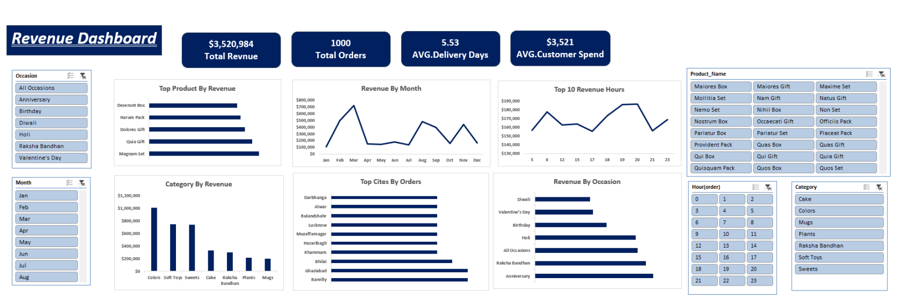

# 📈 Commercial Revenue & Sales Performance Intelligence

An enterprise-grade commercial revenue analytics solution built in Microsoft Excel using Power Query, Power Pivot (Star Schema), and advanced DAX to evaluate sales velocity, order fulfillment lead times, and customer spending behavior across products, cities, and seasonal occasions.

---

## 1. Project Title & Overview

### Business Problem
Commercial leadership and sales directors lacked a consolidated analytical platform to monitor revenue streams, order volumes, fulfillment logistics, and customer purchasing patterns across disparate product lines and geographic territories. Critical operational bottlenecks included:
1. **Unmonitored Margin Leaks:** Inability to track high-volume versus high-margin product categories led to uncontrolled discounting and margin erosion.
2. **Logistics Fulfillment Delays:** Commercial teams had no visibility into delivery lead times, obscuring shipping bottlenecks across key regional markets.
3. **Temporal Blind Spots:** Lack of granular time intelligence obscured peak customer ordering hours and seasonal demand surges, resulting in misallocated ad spend and stockouts.

### Solution & Scope
To address these challenges, a robust analytical architecture was developed in **Microsoft Excel**:
- **Automated ETL Pipeline:** Ingested and transformed multi-table transactional data (`customers.csv`, `orders.csv`, `products.csv`) via **Power Query**, cleansing data types, extracting order hour and calendar attributes, and validating data integrity.
- **Relational Data Architecture:** Architected an enterprise **Star Schema** in **Power Pivot**, linking normalized dimensions (`dCustomer`, `dProduct`, `Calendar`) to the central transactional fact table (`fOrders`) with 1-to-many single-direction relationships.
- **Executive Dashboard Interface:** Built a dark-accented executive reporting suite featuring calculated DAX measures and multi-dimensional slicers (Occasion, Month, Product Name, Order Hour, Category) for real-time commercial drill-downs.

---

## 2. Tech Stack

| Technology | Role in Project |
| :--- | :--- |
| **Microsoft Excel & Power Pivot** | Relational Star Schema data modeling, multi-table relationships, Pivot Charts, and executive dashboard interface design. |
| **DAX (Data Analysis Expressions)** | Authoring business-critical measures (`Total Revenue`, `Avg Customer Spend`, `Average Delivery Days`, and occasion revenue share). |
| **Power Query (M Engine)** | Automated ETL ingestion, schema standardization, date/time extraction, and dimension table normalization. |
| **Relational Data Modeling** | Enterprise Star Schema architecture connecting transactional facts (`fOrders`) to dimension tables (`dCustomer`, `dProduct`, `Calendar`). |

---

## 3. Dashboard Preview / Project Visuals

### Executive Revenue & Operational Dashboard
Comprehensive executive interface tracking \$3.52M in revenue, 1,000 orders, average customer spend (\$3,521), delivery lead times (5.53 days), monthly trends, category breakdown, top purchasing cities, peak ordering hours, and occasion-based sales.

---

### Data Model Architecture (Star Schema)
Robust dimensional model implemented in Power Pivot with 1-to-many single-direction relationships connecting normalized dimensions (`dCustomer`, `dProduct`, `Calendar`) to the central fact table (`fOrders`).

---

## 4. Key Insights

* **\$3.52M Gross Revenue Across 1,000 Orders (\$3,521 Average Order Value):**
  The commercial portfolio generated **\$3,520,984** across exactly **1,000 fulfilled orders**, yielding an Average Customer Spend of **\$3,521**. Revenue concentration is heavily anchored by the **"Colors"** category (**\$1,020,000**, ~29% of gross revenue), followed by **Soft Toys (\$740,000)** and **Sweets (\$730,000)**. Conversely, categories such as "Plants" (\$210K) and "Mugs" (\$200K) exhibit low volume and require strategic cross-merchandising.

* **Pronounced March Demand Surge & Occasion-Centric Spend:**
  Revenue exhibits extreme seasonality: a massive peak in **March (~$720,000)**, followed by secondary demand waves in **August (~$500,000)** and **November (~$450,000)**, while the April–July post-holiday period experiences a prolonged lull (~$150,000/month). By consumer occasion, **Anniversary celebrations (\$680,000)** and **Raksha Bandhan (\$650,000)** represent the highest grossing seasonal drivers.

* **Dual Daily Ordering Peaks & Logistics Fulfillment Lead Time (5.53 Days):**
  Customer order placement concentrates heavily around two distinct daily intervals: an evening surge between **19:00–20:00 (7 PM–8 PM, ~$185,000)** and an early morning peak at **6:00 AM (~$180,000)**. Tier-2 regional cities dominate purchasing volume, led by **Bareilly, Ghaziabad, and Bhilai** (~70–75 orders each). Fulfillment logistics average **5.53 calendar days** from order placement to customer delivery.

---

## 5. Business Recommendations

1. **Synchronize Marketing & Promotional Ad Spend with Peak Daily Windows:**
   - Concentrate digital push notifications, flash promotions, and paid ad spend during the two peak buying windows (**6:00 AM** and **7:00–8:00 PM**) to maximize conversion rates and return on ad spend (ROAS).
   - Ramp up seasonal marketing and inventory positioning 3–4 weeks prior to March and August to fully capitalize on Anniversary and Raksha Bandhan surges.

2. **Bundle Core High-Volume Categories with Margin Laggards:**
   - Create curated gift hampers combining top sellers ("Colors", "Soft Toys", "Sweets") with underperforming product lines ("Plants", "Mugs") to lift average basket size and eliminate slow-moving inventory.

3. **Optimize Logistics Routing in Top Regional Cities:**
   - Establish dedicated fulfillment corridors and local carrier partnerships in top-volume regional hubs (**Bareilly, Ghaziabad, Bhilai**) to compress the 5.53-day delivery window to under 4 days, minimizing transit cancellations.

---

## 6. Interactive Dashboard & Model Access

The complete data model and interactive dashboard are available for download and exploration:

* **Live Portfolio Showcase & CSV Downloads:**
  👉 **[Explore Project Showcase on Portfolio](https://ahmedrasmyabdelrheem.github.io/#sales-project)**
* **Direct Excel Power Pivot Model:**
  👉 **[Download Sales_Performance_Dashboard.xlsx](https://ahmedrasmyabdelrheem.github.io/assets/Sales_Performance_Dashboard.xlsx)**
